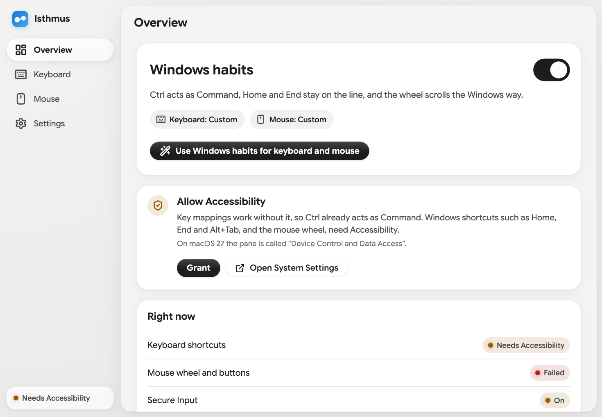

<div align="center">



<h1>Isthmus</h1>

<p><em>Two systems, one pair of hands.</em></p>

<p>
  <a href="https://www.rust-lang.org/"></a>
  <a href="https://flutter.dev/"></a>
  <a href="https://www.apple.com/macos/"></a>
  <a href="LICENSE"></a>
</p>

<p>
  <a href="README.md"><b>English</b></a> ·
  <a href="README.zh-CN.md">中文</a>
</p>

</div>

---

**Isthmus** makes a Mac's keyboard and mouse behave the way Windows taught
your hands. Ctrl+C copies, Home goes to the start of the line, Alt+Tab
switches apps, and the mouse wheel scrolls three lines a notch in the
Windows direction while the trackpad keeps natural scrolling. The keyboard
and the mouse switch on separately, each keyboard and each mouse has its own
settings, and one click turns all of it on. Isthmus lives in the menu bar,
and every change it makes to macOS is put back when it stops.

```text
 keyboard ──► HID mapping ─────────► event tap ────────────────► apps
              Ctrl acts as Command   Home/End, Ctrl+arrows,
              Win and Alt in place   Alt+Tab, Win+D, ...;
              (per keyboard)         Ctrl+Q is not Quit
 mouse ─────► pointer speed ───────► event tap ────────────────► apps
              Windows 1–20 scale     Windows wheel direction,
              (per mouse)            3 lines a notch, side buttons
 trackpad ─────────────────────────────────────────────────────► apps, untouched
```

## What it does

- **Windows keys on any keyboard** — Ctrl acts as Command, and Win and Alt
  sit where Windows puts them. The mapping is made in the keyboard's own HID
  service, so every app sees a real Command key, password fields included.
  A PC keyboard and a Mac keyboard are told apart, and a Mac keyboard can
  stay exactly as it is
  ([keyboard](docs/keyboard-and-mouse.md#keyboard)).
- **The shortcuts one key cannot express** — Home/End by line, Ctrl+arrows
  and Ctrl+Backspace by word, Alt+Tab, Alt+F4, Win+D, Win+E, Win+L,
  Win+arrows, PrintScreen, Ctrl+Shift+Esc and more, in eight groups that
  switch separately. Ctrl+Q, Ctrl+H and Ctrl+Tab are kept from becoming
  Quit, Hide and the app switcher
  ([shortcut table](docs/keyboard-and-mouse.md#shortcut-table)).
- **Apps that need Ctrl** — terminals keep Ctrl as Ctrl (Ctrl+C
  interrupts) and copy and paste with Ctrl+Shift+C/V; JetBrains IDEs, Emacs
  and Vim keep Ctrl; virtual machines and remote desktops get every key by
  position, with nothing translated, so the Windows inside sees Ctrl, Win
  and Alt. Rules of your own win over the built-in lists
  ([app classes](docs/keyboard-and-mouse.md#app-classes)).
- **A Windows mouse wheel** — rolling toward you scrolls down, each notch
  scrolls three lines without acceleration, buttons 4 and 5 go back and
  forward, and Ctrl+wheel zooms. Only notched wheels change: the trackpad
  and the Magic Mouse keep natural scrolling
  ([mouse](docs/keyboard-and-mouse.md#mouse)).
- **Windows pointer speed** — Windows' 1–20 scale with "Enhance pointer
  precision" off, set per mouse
  ([mouse](docs/keyboard-and-mouse.md#mouse)).
- **Separately or all at once** — the keyboard and the mouse each have their
  own switch, each device its own settings, and the Windows and Mac presets
  apply to both or either in one click
  ([settings](docs/keyboard-and-mouse.md#settings-and-one-click)).
- **Everything put back** — every change Isthmus makes to macOS is written
  down before it is made, and put back on quit, on pause, when another user
  takes the screen and, after a crash, at the next start. A KVM switch looks
  like a replug, and Isthmus applies the settings again
  ([putting it back](docs/keyboard-and-mouse.md#system-changes-and-putting-them-back)).

## How it works

Two layers do the keyboard. A HID mapping on each Windows-style keyboard's
own HID services makes its Ctrl a Command key before any app sees it, so it
works where nothing else reaches, such as a password field. One event tap
then translates what a single key cannot: a Home that stops at the line, an
Alt+Tab that keeps the switcher open while Alt is held, a Win+D that shows
the desktop. The mapping follows the app in front: in a terminal Ctrl is
Ctrl again, and in a virtual machine every key reaches Windows by position.
The mapped keys arrive marked as right-hand modifiers, so the tap tells a
Windows-style keyboard's Ctrl from a MacBook's own Command and leaves the
MacBook's keys alone.

The mouse needs the tap for the wheel and the side buttons, and HID
properties for pointer speed. Each wheel event names the device that sent
it, so each mouse gets its own settings; trackpad and smooth-scrolling
events pass untouched.

Worth knowing:

- **Accessibility is required for the tap.** macOS refuses an event tap
  that changes events to an app without it. Without it, keyboards get only
  the Windows key positions and mice only pointer speed. On macOS 27 the
  pane is called Device Control and Data Access.
- **Secure Input pauses the tap.** In password fields Ctrl+V still pastes,
  but nothing is translated or guarded: Home/End and Alt+Tab stop, and
  Ctrl+Q is Quit. In a terminal with Secure Keyboard Entry on, the terminal
  translations stop too: copy and paste with Win+C/V there, since
  Ctrl+Shift+C acts as Ctrl+C and interrupts the running command.
- **Keys are matched by position.** Rules follow US key positions, so on a
  German keyboard Ctrl+Z is the key labelled Y.
- **macOS 13 or later.** Linear pointer speed needs macOS 14 (on 13,
  acceleration is switched off instead), and the Win+arrow tiling shortcuts
  need macOS 15.
- **One Isthmus per Mac.** Key mappings and pointer settings belong to the
  whole machine, so a second copy, such as another build or `isthmus run`,
  runs but changes nothing.
- **Karabiner-Elements takes keyboards whole.** A keyboard it has seized
  never sees Isthmus's mapping; the app says so.

## Get started

**1. Build the app** on a Mac with Xcode, Rust and Flutter:

```bash
make build-ui-macos-release   # builds the Rust library, then Isthmus.app
open ui/build/macos/Build/Products/Release/Isthmus.app
```

Isthmus appears in the menu bar, switched off: nothing changes yet.

**2. Allow Accessibility** when Isthmus asks, in System Settings › Privacy &
Security. macOS sometimes applies a new grant only after the app restarts;
the app says when.

**3. Choose Windows habits** for the keyboard, the mouse or both, then
adjust each device on its page. Choosing Mac, or switching Isthmus off, puts
the Mac back.

The `isthmus` command works without the app:

```bash
make build-isthmus-cli          # target/release/isthmus
isthmus devices                 # keyboards, mice and trackpads, with each keyboard's layout
isthmus status                  # what is applied now, and what is missing
isthmus preset windows          # Windows habits for keyboard and mouse; `mac` puts the Mac back
isthmus inspect                 # what each device sends; key events need Input Monitoring
```

`isthmus settings` prints the settings, `isthmus run` runs without the app,
and `isthmus restore` puts back what a crashed run left.

If something goes wrong:

```bash
tccutil reset Accessibility dev.acking.isthmus   # a grant that stopped working after a rebuild
hidutil property --set '{"UserKeyMapping":[]}'   # clear every key mapping by hand, yours included
```

Unplugging and replugging a keyboard or mouse, or restarting the Mac, also
clears everything Isthmus set.

Every setting and shortcut: [keyboard and mouse](docs/keyboard-and-mouse.md)
· building and running the app: [ui/README.md](ui/README.md) · what changed:
[changelog](CHANGELOG.md).

## What comes next

The keyboard and mouse are the first part. Isthmus is meant to grow into
finding your other computers on the local network, pairing with a short
code, sharing files between paired devices, aligning how a display looks on
both systems, and one keyboard and mouse across them. None of it is built;
[the roadmap](docs/roadmap.md) describes each step and what it needs.

## Documentation

| | |
| --- | --- |
| **Use** | [Keyboard and mouse](docs/keyboard-and-mouse.md) · [Changelog](CHANGELOG.md) |
| **App** | [Building and running it](ui/README.md) |
| **Project** | [Architecture](docs/architecture.md) · [Roadmap](docs/roadmap.md) · [Rust engineering guide](docs/rust-engineering-guide.md) |

All pages: [docs index](docs/README.md).

## Development

`crates/` holds the Rust workspace (`isthmus-core` for the data directory,
state files and the instance lock; `isthmus-input` for the keyboard and
mouse service; `isthmus-cli` for the `isthmus` command), `ui/` the Flutter
app with its C ABI and the macOS Runner, and `scripts/` the build steps. The
rules a change must keep are in [AGENTS.md](AGENTS.md).

```bash
make build-ui-macos-local   # Isthmus-local.app, with its own Accessibility grant
cargo test --workspace --all-features
```

## License

[MIT](LICENSE)
