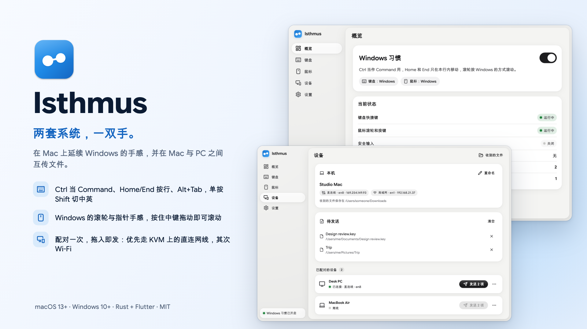

<div align="center">



<h1>Isthmus</h1>

<p><em>两套系统，一双手。</em></p>

<p>
  <a href="https://www.rust-lang.org/"></a>
  <a href="https://flutter.dev/"></a>
  <a href="https://www.apple.com/macos/"></a>
  <a href="LICENSE"></a>
</p>

<p>
  <a href="README.md">English</a> ·
  <a href="README.zh-CN.md"><b>中文</b></a>
</p>

</div>

---

**Isthmus** 让 Mac 的键盘和鼠标按 Windows 教会你双手的方式工作。Ctrl+C 复制，Home 回到行首，Alt+Tab 切换应用，鼠标滚轮按 Windows 的方向每格滚动三行，触控板仍然保持自然滚动。键盘和鼠标分别开启，每个键盘、每只鼠标都有自己的设置，一键就能全部开启。Isthmus 常驻菜单栏，它对 macOS 做的每一处改动都会在它停下时恢复原样。

```text
 键盘 ──────► HID 映射 ────────────► 事件 tap ─────────────────► 应用
              Ctrl 充当 Command      Home/End、Ctrl+方向键、
              Win、Alt 归位          Alt+Tab、Win+D……；
              （按键盘）             Ctrl+Q 不再是退出
 鼠标 ──────► 指针速度 ────────────► 事件 tap ─────────────────► 应用
              Windows 1–20 档        Windows 滚轮方向、
              （按鼠标）             每格 3 行、侧键
 触控板 ───────────────────────────────────────────────────────► 应用，不改动
```

## 能做什么

- **任何键盘都是 Windows 的键位**：Ctrl 充当 Command，Win 和 Alt 回到 Windows 上的位置。映射做在键盘自己的 HID 服务上，所以每个应用看到的都是真正的 Command 键，密码框也一样。PC 键盘和 Mac 键盘会被区分开，Mac 键盘可以原样保留（[键盘](docs/keyboard-and-mouse.zh-CN.md#键盘)）。
- **单个按键表达不了的快捷键**：Home/End 按行、Ctrl+方向键和 Ctrl+Backspace 按词、Alt+Tab、Alt+F4、Win+D、Win+E、Win+L、Win+方向键、PrintScreen、Ctrl+Shift+Esc 等，分成八组，各自开关。Ctrl+Q、Ctrl+H 和 Ctrl+Tab 不会变成退出、隐藏和应用切换器（[快捷键表](docs/keyboard-and-mouse.zh-CN.md#快捷键表)）。
- **需要 Ctrl 的应用**：终端里 Ctrl 仍是 Ctrl（Ctrl+C 中断），用 Ctrl+Shift+C/V 复制粘贴；JetBrains IDE、Emacs 和 Vim 保留 Ctrl；虚拟机和远程桌面按位置收到每个键、不做任何转换，里面的 Windows 看到的就是 Ctrl、Win 和 Alt。你自己的规则优先于内置列表（[应用类别](docs/keyboard-and-mouse.zh-CN.md#应用类别)）。
- **Windows 的鼠标滚轮**：滚轮向自己滚是向下翻，每格滚动三行、没有加速，4、5 号键后退和前进，Ctrl+滚轮缩放。只改逐格滚动的滚轮：触控板和妙控鼠标保持自然滚动（[鼠标](docs/keyboard-and-mouse.zh-CN.md#鼠标)）。
- **Windows 的指针速度**：Windows 的 1–20 档，关闭「提高指针精确度」时的手感，每只鼠标分别设置（[鼠标](docs/keyboard-and-mouse.zh-CN.md#鼠标)）。
- **分开调或一起切**：键盘和鼠标各有自己的开关，每个设备有自己的设置，Windows 和 Mac 两个预设一键作用于两者或其中之一（[设置](docs/keyboard-and-mouse.zh-CN.md#设置与一键切换)）。
- **一切都会恢复**：Isthmus 对 macOS 的每一处改动都先记下再执行，并在退出、暂停、切换到其他用户时恢复，崩溃后则在下次启动时恢复。KVM 切换等同于重新插拔，Isthmus 会重新应用设置（[恢复](docs/keyboard-and-mouse.zh-CN.md#系统改动与恢复)）。
- **电脑之间互传文件**：另一台 Mac 或 PC 上的 Isthmus 会自动出现；用 6 位配对码配对一次，之后两台会自己连上。把文件拖到窗口里，在设备旁点「发送」。优先走两台之间的直连线（比如插在 KVM 上的 USB 网卡），其次走共同的网络，传输中一条断了会在另一条上接着传（[文件互传](docs/file-sharing.zh-CN.md)）。
- **不休眠，但屏幕照样熄灭**：设置或菜单栏里一个开关，让电脑不会自己进入睡眠，屏幕仍按系统设置自动熄灭：下载、编译、远程会话和文件互传继续运行，显示器照样省电。Mac 和 PC 都支持。
- **一键更新**：「设置 › 关于」可以检查新版本，默认也会每天自动检查两次左右（可关闭）。点「更新」会下载新版本、用发布附带的签名清单校验，再替换到位：Isthmus 关闭后以新版本重新打开，辅助功能授权保持不变（[更新](docs/updates.md)，英文）。

## 工作原理

键盘由两层完成。每个 Windows 风格键盘自己的 HID 服务上有一份映射，在任何应用看到之前就把它的 Ctrl 变成 Command 键，所以在别的手段够不着的地方也有效，比如密码框。然后由一个事件 tap 转换单个按键表达不了的东西：停在行内的 Home，按住 Alt 时一直开着切换器的 Alt+Tab，显示桌面的 Win+D。映射跟随最前面的应用：在终端里 Ctrl 又是 Ctrl，在虚拟机里每个键按位置到达 Windows。映射后的键带着右侧修饰键的标记，所以 tap 能把 Windows 风格键盘的 Ctrl 和 MacBook 自带的 Command 区分开，不碰 MacBook 的按键。

鼠标的滚轮和侧键靠 tap，指针速度靠 HID 属性。每个滚轮事件都写明是哪个设备发出的，所以每只鼠标有自己的设置；触控板和平滑滚动的事件原样通过。

需要了解的边界：

- **tap 需要辅助功能权限。** 没有这项权限的应用，macOS 不允许它用事件 tap 修改事件。没有权限时，键盘只有 Windows 的键位，鼠标只有指针速度。macOS 27 上这个面板叫「设备控制和数据访问」。
- **安全输入会暂停 tap。** 在密码框里 Ctrl+V 仍能粘贴，但快捷键不再转换，也不再守卫：Home/End 和 Alt+Tab 失效，Ctrl+Q 就是退出。在开启了「安全键盘输入」的终端里，终端的转换也停止：那里请用 Win+C/V 复制粘贴，因为 Ctrl+Shift+C 等于 Ctrl+C，会中断正在运行的命令。
- **按键按位置匹配。** 规则按美式键盘的位置匹配，所以在德语键盘上，Ctrl+Z 是标着 Y 的那个键。
- **需要 macOS 13 或更高版本。** 线性指针速度需要 macOS 14（在 13 上改为关闭加速），Win+方向键的窗口拼贴需要 macOS 15。
- **一台 Mac 只运行一个 Isthmus。** 键位映射和指针设置属于整台机器，所以第二份副本（另一个构建，或 `isthmus run`）能运行，但什么都不改。
- **Karabiner-Elements 会独占键盘。** 被它接管的键盘收不到 Isthmus 的映射；应用会提示这一点。

## 快速开始

**1. 获取应用。** 从 [Releases](https://github.com/acking-you/isthmus/releases) 下载 `Isthmus-macos-arm64.dmg`（Apple 芯片）或 `Isthmus-macos-x86_64.dmg`（Intel），打开后把 Isthmus 拖进「应用程序」。安装包已用 Developer ID 签名并经过公证，之后可在「设置 › 关于」里自动更新。也可以在装有 Xcode、Rust 和 Flutter 的 Mac 上自己构建：

```bash
make build-ui-macos-release   # 先构建 Rust 库，再构建 Isthmus.app
open ui/build/macos/Build/Products/Release/Isthmus.app
```

Isthmus 出现在菜单栏里，处于关闭状态：此时什么都还没改。

**2. 在 Isthmus 请求时允许辅助功能权限**，位置在「系统设置 › 隐私与安全性」。macOS 有时要等应用重启后才让新授权生效；需要重启时应用会提示。

**3. 为键盘、鼠标或两者选择 Windows 习惯**，再到各自的页面里逐个设备调整。选择 Mac，或关闭 Isthmus，就回到 Mac 原样。

`isthmus` 命令不依赖应用也能用：

```bash
make build-isthmus-cli          # target/release/isthmus
isthmus devices                 # 键盘、鼠标和触控板，以及每个键盘的布局
isthmus status                  # 当前应用了什么，缺了什么
isthmus preset windows          # 键盘和鼠标都用 Windows 习惯；`mac` 回到 Mac 原样
isthmus inspect                 # 每个设备实际发出什么；键盘事件需要输入监控权限
```

`isthmus settings` 打印设置，`isthmus run` 不开应用直接运行，`isthmus restore` 恢复崩溃的那次运行留下的改动。

出了问题时：

```bash
tccutil reset Accessibility dev.acking.isthmus   # 重新构建后失效的授权
hidutil property --set '{"UserKeyMapping":[]}'   # 手动清除所有键位映射，包括你自己的
```

拔下再插上键盘或鼠标，或者重启 Mac，同样会清除 Isthmus 设置的一切。

**在 PC 上**，Windows 版提供文件互传和防休眠：从 [Releases](https://github.com/acking-you/isthmus/releases) 运行 `Isthmus-windows-x86_64-setup.exe` 一键安装（之后可在应用内自动更新），或解压免安装的 `Isthmus-windows-x86_64.zip`。自己构建（需要 Rust、Flutter 和 Visual Studio 的 C++ 工具，在 PowerShell 里）：

```bash
make build-ui-windows-release   # 先构建 isthmus_ffi.dll，再构建 Isthmus.exe
make release-ui-windows         # 在 ui/dist 生成安装包和 zip（需要 Inno Setup 6）
```

每项设置与快捷键见[键盘与鼠标](docs/keyboard-and-mouse.zh-CN.md)；配对与传文件见[文件互传](docs/file-sharing.zh-CN.md)；构建与运行应用见 [ui/README.md](ui/README.md)（英文）；改动记录见[更新日志](CHANGELOG.md)。

## 接下来

键盘、鼠标和文件互传已经完成。接下来：让同一块显示器在两套系统上看起来一致，以及用一套键盘鼠标操作并排的两台电脑；[路线图](docs/roadmap.md)（英文）描述了每一步以及它需要什么。

## 文档

| | |
| --- | --- |
| **使用** | [键盘与鼠标](docs/keyboard-and-mouse.zh-CN.md) · [文件互传](docs/file-sharing.zh-CN.md) · [更新日志](CHANGELOG.md) |
| **应用** | [构建与运行](ui/README.md) |
| **项目** | [架构](docs/architecture.md) · [路线图](docs/roadmap.md) · [Rust 工程指南](docs/rust-engineering-guide.md) |

全部文档：[文档索引](docs/README.md)（英文）。

## 开发

`crates/` 是 Rust workspace（`isthmus-core` 负责数据目录、状态文件和单实例锁，`isthmus-input` 是键盘鼠标服务，`isthmus-link` 负责发现、配对和传文件，`isthmus-cli` 是 `isthmus` 命令），`ui/` 是 Flutter 应用及其 C ABI 和 macOS、Windows 两个 Runner，`scripts/` 是构建步骤。改动必须遵守的规则见 [AGENTS.md](AGENTS.md)。

```bash
make build-ui-macos-local   # Isthmus-local.app，拥有独立的辅助功能授权
cargo test --workspace --all-features
```

## 许可证

[MIT](LICENSE)
